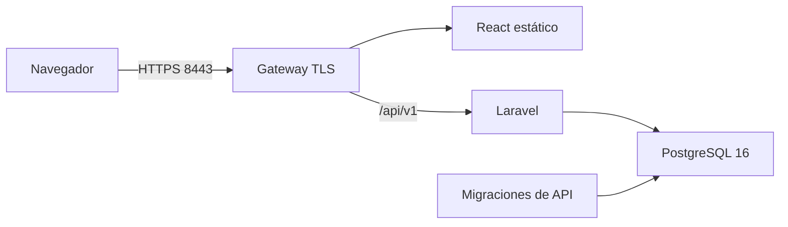

# test-manager-library-3145555-infra

> **Prueba técnica · Ficha ADSO 3145555**
> Horario: **miércoles 14 de octubre de 2026, de 6:50 a. m. a 11:00 a. m.** (hora Colombia). Entrega a las **11:00 a. m.**

Este repositorio es la **infraestructura** de *Manager Library*: contenedores, red, volúmenes y el motor de base de datos vacío. **Empieza vacío a propósito**: se construye en el fork de cada aprendiz.

## Instrucciones

Cada aprendiz debe **crear el fork** de los seis repositorios del proyecto y **resolver el proyecto
con el spec planteado**.

1. Hacer fork, a su cuenta de GitHub, de cada repositorio de la tabla del final.
2. Leer el spec en [`test-manager-library-3145555-docs`](https://github.com/code-sena/test-manager-library-3145555-docs).
   Se entrega en dos versiones: `spec-python/` y `spec-.net/`.
3. Desarrollar en los forks.

## El reto se desarrolla con React y PHP (Laravel)

El spec está escrito para Python y para .NET, pero el reto **no** se hace en esos lenguajes:

| Capa | Tecnología del reto |
|---|---|
| Frontend | React |
| Backend | PHP con Laravel |

Lo que el spec define sobre el negocio —historias, criterios de aceptación, reglas, contrato de la
API, modelo de datos— se respeta. Lo que define sobre la tecnología se traduce a React y Laravel.

## La prueba no consiste en escribir el código

El propósito principal es ver la **capacidad de desempeño con SDD** (*Spec-Driven Development*,
desarrollo guiado por especificación): cómo se lee, se interpreta y se aplica una especificación
para llevarla a un stack distinto. El código es el medio, no el fin.

## Entrega

Cuenta lo que quede **subido a los forks antes de las 11:00 a. m.** Lo que llegue después no se revisa.
No hay prórroga: suban avances parciales con commits pequeños durante la prueba.

## Los seis repositorios

| Repositorio | Qué va ahí |
|---|---|
| [`test-manager-library-3145555-docs`](https://github.com/code-sena/test-manager-library-3145555-docs) | El spec: `spec-python/` y `spec-.net/` |
| [`test-manager-library-3145555-api`](https://github.com/code-sena/test-manager-library-3145555-api) | Backend en PHP (Laravel) |
| [`test-manager-library-3145555-app`](https://github.com/code-sena/test-manager-library-3145555-app) | Frontend en React |
| [`test-manager-library-3145555-page`](https://github.com/code-sena/test-manager-library-3145555-page) | Sitio público estático de presentación |
| [`test-manager-library-3145555-infra`](https://github.com/code-sena/test-manager-library-3145555-infra) | Contenedores, red, volúmenes y motor de base de datos vacío |
| [`test-manager-library-3145555-tool`](https://github.com/code-sena/test-manager-library-3145555-tool) | Utilidades: sembrador de datos de demostración |

## T-20 · Despliegue integrado

El [plan previo](evidence/t-20-plan.md) fue publicado antes de configurar servicios. La
[evidencia de ejecución](evidence/t-20.md) distingue verificación de configuración, motor vacío,
recorrido real y resultados pendientes. El esquema sigue siendo propiedad exclusiva de API.



Solo el gateway publica un puerto, limitado a 127.0.0.1. API y base no se publican al host.
La base usa una red interna de datos; React/gateway/API comparten otra red interna. La base
y las portadas tienen volúmenes persistentes separados. Infra no define tablas, índices,
restricciones, categorías ni archivos SQL de inicialización.

### Preparación local

Requisitos: Docker con motor Linux y Compose, Node.js 22 o superior y OpenSSL. En Windows
se admite el OpenSSL de Git en su ruta habitual; `OPENSSL_BIN` permite indicar otro ejecutable.
Mantener estos tres checkouts como carpetas hermanas:

```text
test-manager-library-3145555-infra/
test-manager-library-3145555-api/
test-manager-library-3145555-app/
```

API debe incluir el arranque T-17 y React su Dockerfile; las revisiones verificadas se indican en
la evidencia. `API_CONTEXT` y `APP_CONTEXT` permiten usar otras rutas, sin modificar los repos vecinos.
Los PR de API/React deben revisarse y fusionarse por separado: este repositorio no los fusiona.

Desde la raíz de infra:

```sh
node scripts/init-local.mjs
docker compose config --quiet
docker compose up --build -d --wait
```

El primer comando genera `.env`, credenciales aleatorias y una CA/certificado locales bajo
`.local/tls`. No sobrescribe una configuración existente ni instala confianza en el sistema.
Los archivos privados están excluidos de Git. Consultar la credencial admin únicamente en el
archivo local `.env`; no pegarlo en PR, capturas ni logs. No ejecutar `docker compose config`
sin `--quiet` al compartir resultados: su salida expandida contiene credenciales.

El motor arranca vacío. El servicio transitorio `migrate`, construido desde API, ejecuta
`php artisan migrate --force --no-interaction`. Solo después de terminar correctamente arranca
Laravel, que aprovisiona el admin desde el entorno; React y el gateway completan el arranque.
Este servicio hace explícita la migración de despliegue y no añade DDL al entrypoint de API.

Abrir `https://localhost:8443` cuando el certificado sea confiable para el navegador. La CA local
es para desarrollo: el cliente debe confiar en `.local/tls/root-ca.pem`; no usar excepciones que
desactiven la validación TLS. En producción, aportar un certificado de un emisor confiable.
El certificado local dura 30 días y su CA 365 días; su renovación no debe reemplazar las credenciales
persistidas. El gateway recibe solamente certificado/clave de servidor; no recibe la clave de la CA.

En Windows, si decides confiar en esta CA local, este comando importa **su certificado público**
al almacén del usuario actual. No lo ejecuta el inicializador:

```powershell
Import-Certificate -FilePath .\.local\tls\root-ca.pem -CertStoreLocation Cert:\CurrentUser\Root
```

Reiniciar el navegador si es necesario. `PUBLIC_ORIGIN` debe coincidir con el origen de React;
al cambiar `HTTPS_PORT`, actualizarlo también. Los secretos permanecen en entorno privado,
no en variables VITE ni en el bundle de React. El gateway no registra solicitudes de acceso.

### Datos y parada

```sh
docker compose down
docker compose up -d --wait
```

`down` conserva los volúmenes; las migraciones ya aplicadas no se repiten y el admin existente
conserva su contraseña. Cambiar ADMIN_PASSWORD en `.env` no cambia una cuenta ya provisionada;
cambiar DB_PASSWORD tampoco rota la contraseña de un volumen PostgreSQL existente.
No añadir `--volumes` al despliegue que conserva tus datos: ese parámetro elimina sus volúmenes.

### Verificar T-20 de forma aislada

```sh
node scripts/check-config.mjs
node scripts/verify.mjs
```

La verificación completa construye imágenes y crea un proyecto nuevo `library-check-*`; no utiliza
el nombre de proyecto del despliegue personal. Necesita libre el puerto indicado en HTTPS_PORT.
Levanta primero solo el motor y exige cero tablas ajenas al catálogo del sistema. Luego inicia
los demás servicios, verifica TLS confiable y ejecuta un navegador Chromium con React/Laravel/base
reales. La CA se confía únicamente en el contenedor desechable del navegador.

El recorrido crea datos sintéticos, sube una portada, registra/devuelve un préstamo, consulta el
reporte y comprueba permisos librarian. Produce capturas de catálogo en escritorio/móvil sin
credenciales. Después recrea contenedores conservando volúmenes y verifica datos, sesión nueva
y bytes de portada. Finalmente elimina **solo** su propio proyecto temporal y sus volúmenes.

CI fija los commits públicos de API y React y los digests de PostgreSQL/gateway/navegador. El
verificador captura errores sin publicar configuración expandida, contraseñas, tokens o trazas de
red; los diagnósticos del navegador indican etapa y ubicación de código. Las capturas de datos
sintéticos se conservan siete días. El control de patrones de secretos no detecta todo secreto posible.

### Demostración y límites

Para C-04/T-21, usar un despliegue **aislado** con APP_ENV=demo, CLOCK_MODE=fixed y CLOCK_FIXED_AT
según la secuencia de docs. Tras cambiar el instante, recrear únicamente API; el gateway resuelve
su dirección de nuevo y el sembrador inicia sesión otra vez. No cambiar el reloj del host ni
enviar fechas arbitrarias al contrato HTTP. El modo habitual sigue siendo producción/reloj real.

El sembrador y las mediciones con 5.000 libros pertenecen a tool; el sitio estático, a page.
El navegador automatizado complementa el recorrido manual de T-22, no certifica por sí solo toda
la accesibilidad ni reemplaza la revisión humana de las capturas. El corte original se conserva.
